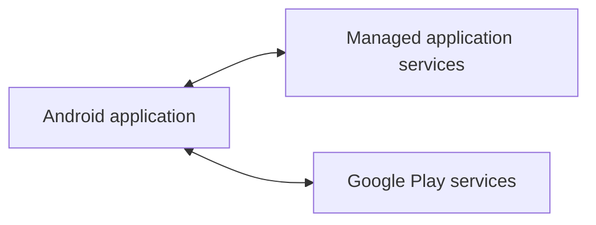

# MuchiLife Technical Overview

MuchiLife combines an Android application, managed application services, and
Google Play services. The public overview stays intentionally broad because the
production source code and operational design are private.

## Public engineering scope

- React Native and TypeScript product development
- Android native integrations and API 24+ compatibility
- Phone and tablet layouts
- Supported account and commerce experiences
- Localization across twelve languages
- Automated checks, monitoring, and release validation

## Delivery principles

- Keep important product rules clear in the interface.
- Treat interrupted operations as normal conditions to design and test for.
- Keep development and production delivery separate.
- Verify behavior across supported Android versions and form factors.
- Keep documentation aligned with the product that is actually shipped.

Non-public design and implementation details are not part of this repository.
