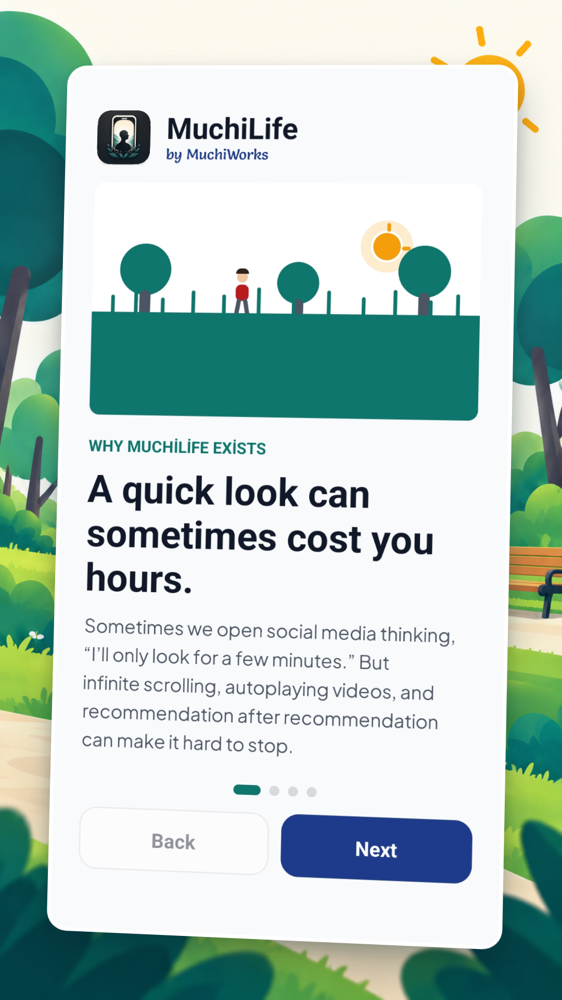
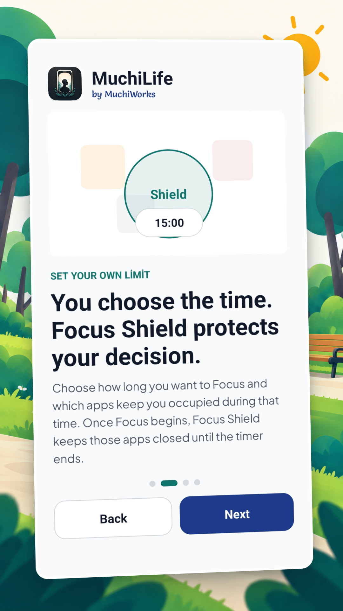
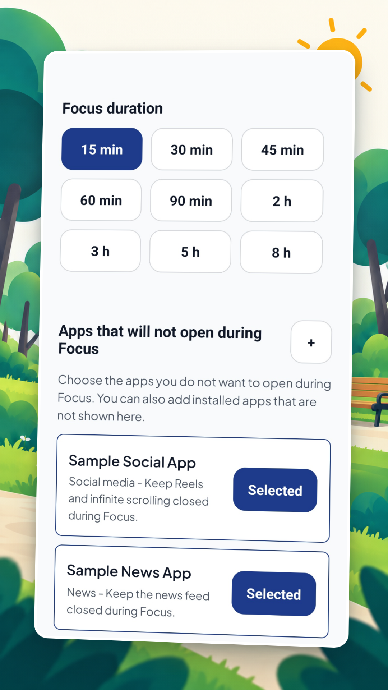
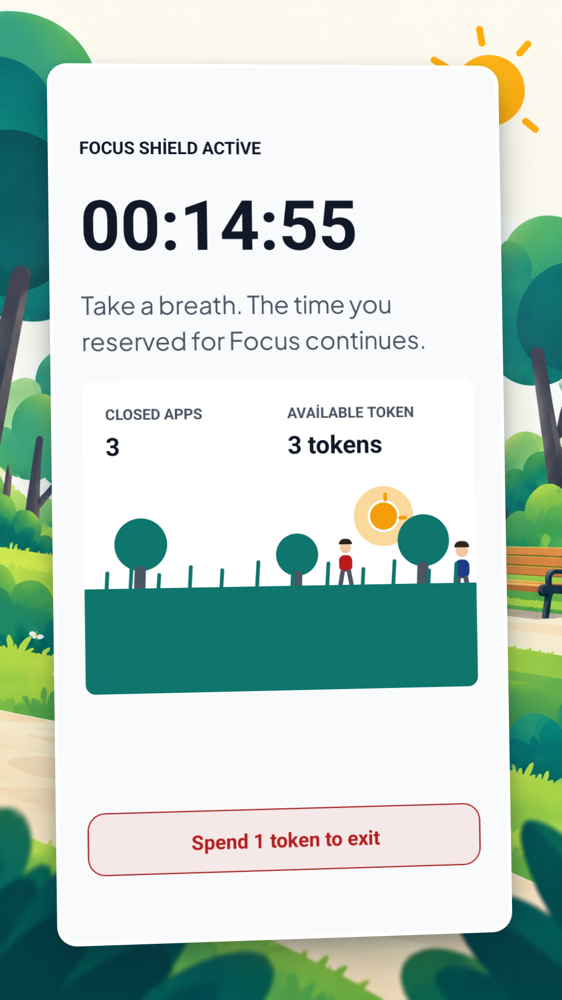
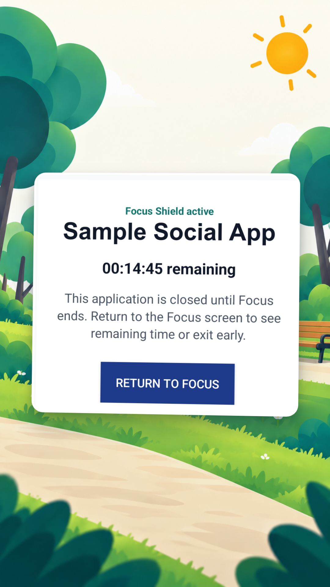
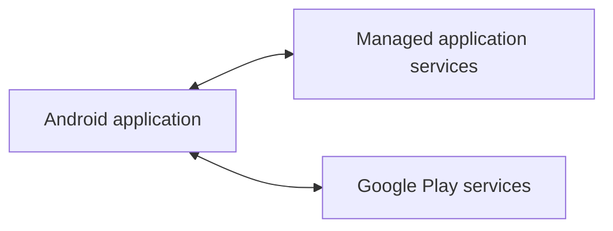

  

<h1 align="center">MuchiLife</h1>

  <strong>Decide what can wait. Protect the time you chose.</strong>

  
  <a href="https://muchiworks.com/products/muchilife">Product website</a> ·
  <a href="PRODUCT_CASE_STUDY.md">Product case study</a> ·
  <a href="ENGINEERING_CASE_STUDY.md">Engineering case study</a> ·
  <a href="ARCHITECTURE.md">Technical overview</a> ·
  <a href="SHIPPING_LOG.md">Shipping log</a>

## Product at a glance

MuchiLife is an Android product that helps people decide which apps can wait,
choose a Focus duration, and protect that time with Focus Shield.

MuchiLife does not ask people to remove their phones from their lives. A person
chooses the duration and the apps they want to keep closed; when the timer ends,
the boundary lifts automatically.

A good result is not spending more time in MuchiLife. It is completing the Focus
you planned and returning to your studies, work, book, or anything else you chose.

The product does not depend on third-party advertising or engagement loops.

**Current status:** Available on [Google Play](https://play.google.com/store/apps/details?id=com.muchiworks.muchilife).

## Product flow

| Decide why | See how it works | Configure Focus |
| --- | --- | --- |
|  |  |  |

| Stay with the timer | Focus Shield |
| --- | --- |
|  |  |

## Engineering scope

- React Native and TypeScript application with Android native integrations
- Android API 24+ support across phones and tablets
- Managed cloud services for application data and supported sign-in methods
- Google Play commerce integration
- Resilient product behavior across common device and network interruptions
- Separate development and production delivery environments
- Twelve localized application experiences and synchronized Android resources
- Testing, monitoring, account controls, and release validation

## Technical overview

The public overview intentionally stays at product-boundary level. Non-public
design and implementation details are omitted.

## Ownership

MuchiLife is designed and engineered by **Metin Çetin**, founder of
**MuchiWorks**. The work spans product direction, mobile engineering, backend
services, commerce, quality, testing, documentation, and Google Play delivery.

## Source availability

The application and backend source code are private and proprietary. This public
repository is a product and engineering case study. It contains no production
credentials, user data, or deployable application source.
